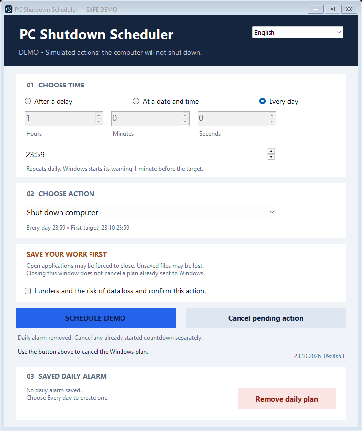

# PC Shutdown Scheduler ⏱️

[](https://github.com/rotesham/pc-shutdown-scheduler/actions/workflows/build.yml)
[](LICENSE)

A Windows desktop shutdown/restart scheduler with one-off timers, persistent daily alarms, and an **English / Turkish** interface.

[Download the latest release](https://github.com/rotesham/pc-shutdown-scheduler/releases/latest) · [Türkçe](README.tr.md) · [Security](SECURITY.md)



## Features

- Schedule shutdown or restart **after a delay**, **at a specific local date/time**, or **every day**.
- Choose English or Turkish in the application.
- Daily alarms are stored in Windows Task Scheduler and remain configured when the application is closed.
- Separate controls for cancelling a pending Windows power operation and deleting the recurring alarm.
- Explicit confirmation before changes. Opening the application does not schedule anything.
- No installer, account or network connection required for normal use.

## Quick start

1. Download and extract the release ZIP, then open the included executable.
2. Select **After a delay**, **At a date/time**, or **Every day**.
3. Choose the time and **Shut down / Restart**.
4. Save your work, acknowledge the risk, and review the final confirmation.

For example: **Every day → 23:59 → Shut down → Save daily alarm**.

> **Save your work.** Windows may force applications to close when the timer expires. Unsaved data can be lost. Closing this application does **not** cancel a scheduled operation.

## Daily alarm behaviour

- One daily alarm per Windows user; saving a new one replaces the previous one.
- The computer must be running and the Windows user must be logged in. The app does not turn on or wake the computer.
- A Windows countdown starts **60 seconds before** the requested target: a 23:59 target triggers at 23:58.
- If the first target is less than one minute away, the first run is moved to the following day; check the displayed first target.
- Missed runs are not replayed after login. Review the alarm after clock/time-zone changes.
- Cancelling a pending operation does not delete the daily alarm. Deleting a daily alarm does not cancel a countdown that already started; use both controls if necessary.
- The cancel button can affect a pending Windows power operation created by another application.
- Windows scheduling is not a real-time execution guarantee.

## Build and test

Requires Windows with the .NET Framework C# compiler. No NuGet packages are needed. Locally tested on Windows 11.

```powershell
powershell -NoProfile -ExecutionPolicy Bypass -File .\build.ps1
```

Output: `build\PCZamanlayici.exe`. Default tests use pure logic and fake OS backends; they never shut down or restart the computer.

```powershell
# Safe visual demonstration
.\build\PCZamanlayici.exe --demo

# Optional integration: registers only a freshly compiled no-op helper task,
# verifies persistence/update/removal, and cleans it up. Not a pure test.
powershell -NoProfile -ExecutionPolicy Bypass -File .\build.ps1 -RunIntegration
```

## Project layout

- `src/`: application and Windows scheduling adapter
- `tests/`: unit, fake-UI and explicitly opt-in integration tests
- `assets/`: application icon
- `docs/`: demonstration screenshot
- `build.ps1`: offline build and safe default tests

## License and trust

[MIT](LICENSE), copyright rotesham. Releases are **unsigned** and provided **as is**. Review and tests are not a guarantee of perfect security or correctness. Never attach credentials or private logs to issues.
